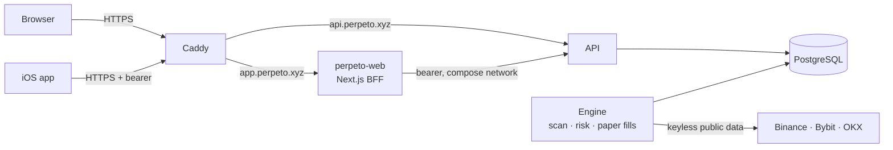

# Perpeto Backend

Perpeto is a public, self-hostable reference implementation of a market-neutral funding-rate arbitrage system. It ranks spot–perpetual and perpetual–perpetual routes across Binance, Bybit and OKX by conservative net return. It coordinates both legs through a durable state machine, bounds unmatched exposure, recovers deterministically from partial fills and ambiguous order outcomes, and reconciles to venue records.

This repository holds the Rust control plane: venue connectors, execution and risk services, persistence, API contracts and Docker Compose deployment. The web platform lives in [`perpeto-web`](https://github.com/ayenisholah/perpeto-web) and the iOS client in [`perpeto-mobile`](https://github.com/ayenisholah/perpeto-mobile). The backend is the only component that evaluates opportunities, holds credentials, submits orders or reconciles accounting.

**Not a trading service.** Real-money LIVE trading is permanently fail-closed. Paper runs on public data, and execution runs only against the operator's own testnet and demo accounts. See [DEC-0015](docs/DECISION.md).

## Status

| Milestone | Status |
|---|---|
| M1 Foundations | **Done**: 136 tests, 11 database-backed suites under a non-`BYPASSRLS` role, CI green |
| M2 Live-data paper trading | **Done**: PAPER on keyless public Binance/Bybit/OKX data, 24 hours on staging ([evidence](docs/evidence/m2/STAGING_SOAK.md)) |
| M3 Public demo | **Done**: [live demo](https://app.perpeto.xyz), read-only viewer, one-command local start ([evidence](docs/evidence/m3/PUBLIC_DEMO.md)) |
| M4 Testnet execution | **Next**: per-venue open → funding → close and forced-recovery evidence |

Already built and kept as hardening, not on the roadmap:
- forced PostgreSQL RLS;
- passkey-authorized actions;
- a Vault Transit secret store;
- credential lifecycle and preflight;
- a hash-chained audit log.

Details: [MILESTONE.md](docs/MILESTONE.md), [PROGRESS.md](docs/PROGRESS.md).

## 5-minute tour

**See it running.** Open the live demo at [app.perpeto.xyz](https://app.perpeto.xyz): a seeded PAPER account trading live public data from Binance, Bybit and OKX, read-only, with no account needed. The web platform is [`perpeto-web`](https://github.com/ayenisholah/perpeto-web) (DEC-0021).

**Run it yourself.** With Docker and Compose v2, from a fresh clone:

```bash
docker compose up --build
```

Then open <http://localhost:3000>. "Open the live demo" shows the seeded tenant, and "Development sign-in" signs you in as a local Owner who can open and close paper positions. The API answers at <http://localhost:8080/readyz>. The first build compiles the Rust workspace, which takes several minutes. Nothing secret is committed: the stack generates its own keys on first run, and `docker compose down -v` forgets them with the database.

**How it fits together:**



The browser holds only an encrypted session cookie; the web server keeps the tokens. The engine scans the venues and runs the strategies; the API serves reads and validated commands. LIVE is locked.

**Evidence:**

| Milestone | Evidence |
|---|---|
| M2 | [Public probe](docs/evidence/m2/PUBLIC_PROBE.md), [24-hour staging run](docs/evidence/m2/STAGING_SOAK.md), [workstation snapshot](docs/evidence/m2/PUBLIC_SNAPSHOT.md) |
| M3 | [Live demo, read-only enforcement and local start](docs/evidence/m3/PUBLIC_DEMO.md) |

**Read the code:**

1. [OVERVIEW.md](docs/OVERVIEW.md): what it is and what it deliberately is not.
2. [ARCHITECTURE.md](docs/ARCHITECTURE.md): the data flow and the isolation boundary.
3. `crates/funding-arb-domain/src/position.rs`: the coordinated two-leg state machine.
4. `crates/connectors/src/book.rs`: snapshot-gated, sequence-checked order books.
5. `crates/auth-service/tests/forced_rls.rs`: isolation evidence that fails when run as a superuser.

## Authoritative documents

Read these before changing code:

1. [PRODUCT_SPEC.md](docs/PRODUCT_SPEC.md)
2. [DECISION.md](docs/DECISION.md)
3. [TRACEABILITY.md](docs/TRACEABILITY.md)
4. [IMPLEMENTATION.md](docs/IMPLEMENTATION.md)
5. [ENGINEERING.md](docs/ENGINEERING.md)

API consumers should also read [API.md](docs/API.md) and the normative [OpenAPI 3.1 contract](schemas/openapi.yaml).

If these disagree, stop and resolve the conflict using the precedence defined in `docs/ENGINEERING.md`.

## Repository shape

```text
crates/                 Shared Rust domain and service crates
bins/                   Deployable Rust binaries
schemas/                OpenAPI and WebSocket contracts
deploy/compose/         Staging Compose manifests
docs/                   Product, governance, progress, testing, and operations records
scripts/                Validation and deployment commands
.github/workflows/      CI, publishing, docs sync, and staging deployment
```

## Local development

Prerequisites are Rust 1.97.0, Docker with Compose v2, and PowerShell 7 or Bash.

```bash
cargo fmt --all -- --check
cargo clippy --workspace --all-targets -- -D warnings
cargo test --workspace
docker compose -f deploy/compose/docker-compose.staging.yml config
```

To run the API against a local PostgreSQL 18 and Redis, use `docker compose -f deploy/compose/docker-compose.dev.yml up -d` and then `bash scripts/dev-run-api.sh`. Building needs `pkg-config` and `libssl-dev`. See [DEPLOYMENT.md](docs/DEPLOYMENT.md) for the details.

The API exposes `/livez`, `/readyz`, and `/entryz` for mode-aware infrastructure and entry validation. Mode behaviour:
- **PAPER** never loads credentials. It is deterministic fixture replay today, and live public data from M2.
- **SANDBOX** permits only explicitly configured testnet/demo writes.
- **SHADOW** is read-only.
- **LIVE** is permanently locked.

## Security

Never commit exchange credentials, signer keys, TOTP material, database passwords, production data, or real account fixtures. GitHub Actions holds only deployment and automation credentials. Runtime secrets live in AWS Secrets Manager and on the staging host. Report security concerns according to [SECURITY.md](.github/SECURITY.md).

## Deployment

Successful `main` builds publish immutable public GHCR images and deploy them in PAPER mode to one EC2 host in AWS `eu-north-1`, defined by the CDK app in `infra/` and reached through SSM rather than SSH (DEC-0020). That staging deployment serves the public demo. The workflow never enables live trading. See [DEPLOYMENT.md](docs/DEPLOYMENT.md).

No license has been granted yet. Until a license decision is recorded, all rights are reserved.
